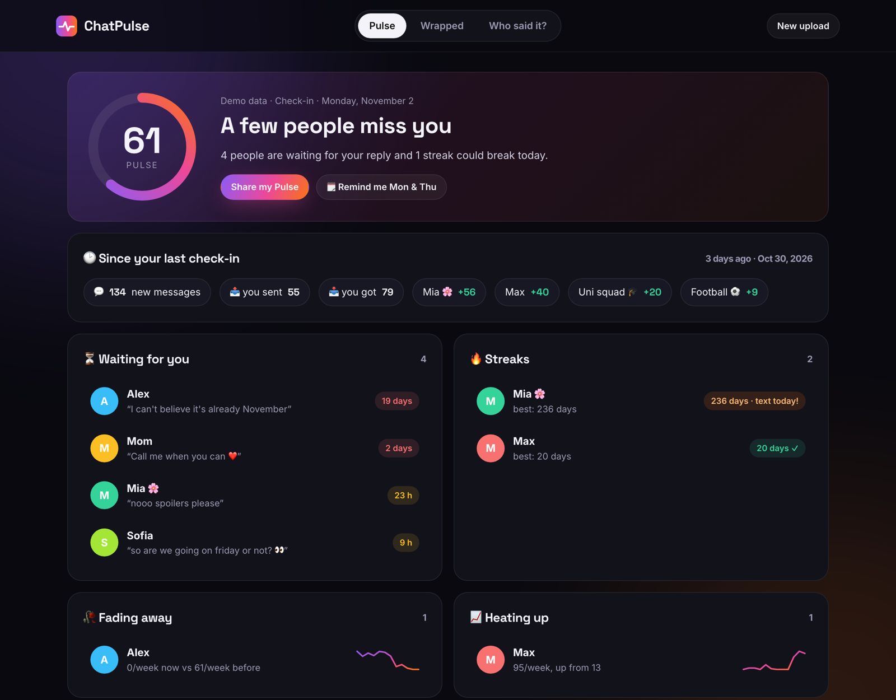

# 🫀 ChatPulse

**Telegram Wrapped that you actually come back to.** Drop your Telegram export and get Wrapped-style stats, plus a twice-a-week **Pulse check-in**: who's waiting for your reply, which friendships are fading, and which streaks are about to break.

Free, no sign-up, and nothing leaves your browser.

👉 **https://econnx.github.io/chatpulse/** (hit *Try the demo* if you don't have an export handy)



## Features

- **Pulse check-in.** A score from 0 to 100, people waiting for your reply, fading chats, chats heating up, streaks at risk, and who texts first in each friendship
- **Since your last check-in.** Every visit is compared with the previous one, so you see what changed
- **Wrapped for any chat.** Messages, words, voice notes, stickers, best streak, busiest day, night-owl %, reply speed, an hour × weekday heatmap, top words and emoji, and your very first message
- **Who said it?** A 10-round game built from real messages in the chat. Beat your best score
- **Share cards.** Story-ready PNGs for Pulse, Wrapped and game scores
- **Calendar reminder.** One click adds a Monday & Thursday check-in to your calendar (.ics)
- Works with a **full account export** or a **single chat**, in any language (English, Ukrainian and Russian stop-words are filtered)

## Export your chats

1. Open **Telegram Desktop** (export isn't available on mobile)
2. One chat: open it → ⋮ → *Export chat history*. All chats: Settings → Advanced → *Export Telegram data*
3. Choose **Machine-readable JSON**, untick photos and videos, then drop `result.json` into ChatPulse

## Privacy

Parsing happens in a Web Worker on your device. Nothing is uploaded. To compare check-ins, only per-chat message counts (no text) are kept in your browser's `localStorage`.

## How it works

- `analyze.js` turns the export into compact stats: per-person counts, reply gaps (median), conversation starters (first message after 6+ h of silence), daily/weekly/monthly activity and streaks
- `worker.js` runs it off the main thread so big exports don't freeze the page
- `app.js` renders Pulse, Wrapped and the game. `cards.js` draws share cards on a canvas
- `demo.js` generates a fake export for the demo

No build step and no dependencies.

## Run locally

```bash
git clone https://github.com/econnx/chatpulse.git
cd chatpulse
python3 -m http.server 8000   # then open http://localhost:8000
```

## License

MIT
